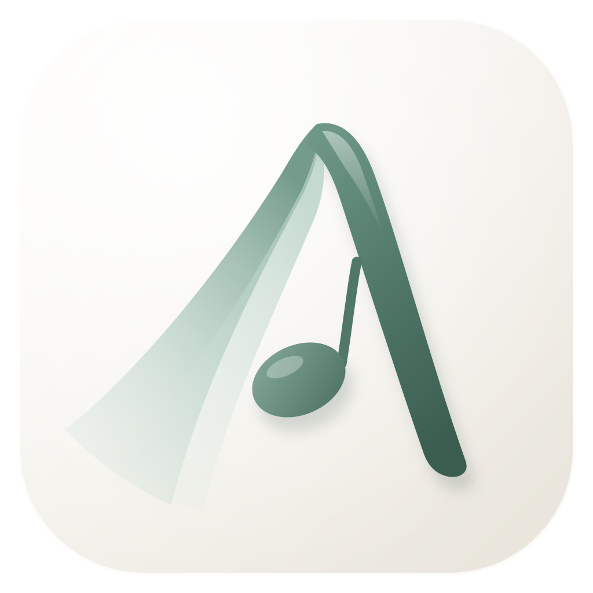

Aria MusicPlayer
======


> 2023 &copy; alanwu-9852

專案簡介
---
（介面語言：English）

播放、收藏與下載串流音樂的桌面播放器，支援 YouTube、Bilibili、Spotify、SoundCloud，並會自動推薦「相關」的歌曲接著播。

支援平台
---

| 平台 | 搜尋 | 貼連結 | 播放方式 |
|---|---|---|---|
| YouTube | ✓ | 影片、Shorts、播放清單 | 直接串流 |
| Bilibili | ✓ | 影片、分 P、b23.tv 短網址 | 直接串流 |
| Spotify | – | 歌曲、專輯、播放清單 | 讀取歌曲資訊後，自動對應到 YouTube 播放（Spotify 音訊有 DRM） |
| SoundCloud | ✓ | 歌曲、歌單 | 直接串流 |
| 其他網站 | – | yt-dlp 支援的連結 | 直接串流 |
| 本機檔案 | – | 「收藏 › 加入檔案…」 | 直接播放 |

自動推薦
---
播放列右側的 ✦ 開啟時，佇列播完會自動接上推薦的歌；「播放中 › 推薦」可以隨時查看與挑選。

- 推薦一律來自 YouTube。正在播的若是 Bilibili、Spotify 等其他平台，會先找出對應的 YouTube 影片當作推薦依據。
- 推薦的是**相關**而不是**相同**：同一首歌的翻唱、Live、Remix、歌詞版、重新上傳、簡繁不同的標題，都視為「同一首」並排除；已播過或已在佇列中的歌也不會再出現。
- **原作優先**：歌詞版、動態歌詞、加速／降速、Nightcore、Remix、二創剪輯、伴奏、AI 翻唱等衍生影片不會被推薦；其他歌的翻唱、Live 可以推薦，但排在官方原版之後。
- 以目前這首為主，再綜合整個佇列（前、中、後段各取一首）與最近播過的歌，並避免同一位歌手連續出現；編輯佇列後推薦會跟著更新。若推薦來源幾乎都是同一位歌手，會從你常一起聽的其他歌手延伸出去。
- 依你的習慣微調順序：你常和這些歌手一起聽的歌手、收藏裡的歌手、同時出現在多個推薦來源的歌手會稍微往前排；合輯與串燒影片會被排除。
- **節奏流動（Tempo Flow）**：「設定 › Playback」開啟後，推薦的歌會優先安排 BPM 相近的接著播，連續幾首相近後再平順地往稍快或稍慢移動（可選 Gentle／Balanced／Strong）；把 70 與 140 這類半拍／雙拍視為相近，估測不可靠或未知時不影響原本的推薦。「Tempo Flow Scope」預設為 Recommendations Only（只調整推薦歌曲）；選 Include Playlists 時，播放播放清單或智慧收藏也會從你點的那首開始依節奏安排這次的播放順序，並隨 BPM 分析逐步調整——播放清單本身的順序不會被改，隨機播放維持隨機，專輯一律照原始曲序，你手動調整佇列後 Aria 就不再重排。不會改變播放速度。BPM 由 Aria 在背景、以閒置優先權分析歌曲中段 30 秒（已下載的讀本機檔，串流只取那一小段，不會下載整首），結果快取一年；知道時會在「播放中」以「· 87 BPM」低調顯示
- **探索程度（Discovery）**：「For You」上方的滑桿，往左（♡）偏向收藏過、常聽的歌手，往右（羅盤）偏向沒聽過的歌手；調整時直接重新排序，不必重新抓取。

使用說明
---
**安裝版**：執行 `Aria-Setup-<版本>.exe`，預設只為目前使用者安裝、不需要系統管理員權限（Windows 10 / 11，64 位元）。安裝檔已包含 Python、VLC 與語音引擎，不必另外安裝任何東西。

**從原始碼執行**：Python 3.10 以上（專案已附 VLC 3.0.18）。

```bash
pip install -r requirements.txt
python main.py
```

**自行打包**：需要 PyInstaller，安裝檔另需 [Inno Setup 6](https://jrsoftware.org/isdl.php)。會產生 `dist/Aria/`（含 `Aria.exe` 的執行目錄，可直接執行或整個資料夾複製帶走）與 `dist/Aria-Setup-<版本>.exe`；加上 `--no-installer` 只產生執行目錄。

```bash
python packaging/build.py
```

YouTube 經常改版。若出現「無法播放」，在「主控台」輸入 `update` 更新 yt-dlp 後重新啟動即可（安裝版也可以：新版會放在資料夾的 `packages/`，比內建的新時才使用）。若電腦裝有 [Deno](https://deno.com) 或 Node.js，yt-dlp 會用它解 YouTube 的簽章，相容性更好。

### 介面

- **播放中**：封面、佇列（可拖曳排序）、推薦、播放紀錄、歌詞；背景會依封面微微上色（Smart Artwork，低飽和度）
- **聆聽階段（Sessions）**：「History › Sessions」把每段連續聆聽整理成卡片，例如「October 9 · Evening Session — 18 tracks」，記錄開始時間、實際聆聽時長、播放順序與期間收藏的歌；點開可重播或存成播放清單。停止聆聽 30 分鐘後該段結束
- **時長適配播放**：佇列上方的計時器按鈕，選 25／45／60 分鐘或自訂（例如 31:25），從收藏或目前佇列挑出總長最接近、又不超過的歌，最後一首會自然結束；從佇列挑時若時間不夠，會用自動推薦補滿；佇列上方與狀態列會倒數剩餘時間
- **搜尋**：輸入關鍵字，或直接貼上任何支援的連結；歌單連結可一次加入佇列或收藏。結果以整理後的歌名與歌手為標題，Live、Cover、Remix 等版本以小標籤另外顯示，原始影片標題放在第二行；同一首歌的不同上傳會收在第一筆底下（「N versions」展開）；重新搜尋或結果更新時清單不會跳回頂端
- **收藏**：工具列只留篩選、Play、List／Disc Rack／Collage 切換與 ⋯ 選單；加入佇列、下載、移除（作用於選取的歌或目前顯示的歌）、加入本機檔案、匯入／匯出歌單（相容 v1 的 JSON）與開啟下載資料夾都在 ⋯ 裡，右鍵與拖曳也照常可用。雙擊只播放那一首（不會把後面的歌加進佇列）。把歌（可多選）從清單或 Disc Rack 拖出來時，頁面下方會出現「Add to Queue」與「Remove from Library」兩個放置區，也可以直接拖到側邊欄的「Now Playing」加入佇列；在 Disc Rack 裡拖曳是調整順序，拖出架子外才會變成拖放
- **List／Disc Rack／Collage**：收藏的工具列右側可切換成 CD 架或封面牆（Collage：每首歌一塊封面，偶爾是 2×2 或長方形，在原本順序中無縫排列，同一首歌每次形狀相同）。Disc Rack 是 CD 架——每首歌是一張直立的單曲 CD，書脊顏色取自封面（低飽和）；滑過或用方向鍵選到時，CD 盒會稍微抽出、露出部分封面，後面的盒子自動讓位，不遮住任何一張。書脊頂端下方一點的短橫線表示可離線播放（實線＝已下載；專輯／播放清單半實線＝部分已下載），未下載的維持原樣、不會變灰；下方資訊列會寫出 Available Offline／Stream Only。單擊選取並在下方顯示資訊，雙擊播放，右鍵與清單相同，拖曳可調整順序（未篩選時）；三種視圖共用篩選與選取，切換時選取的歌保持選取且在畫面內，沒選取時會停在原本看到的位置；下方資訊列沒選取時也保留位置，封面還沒載入時以同樣大小的空格代替，畫面不會跳動
- **唱片架（Shelf）**：收藏的所有集合都在這裡——線上找到的專輯與播放清單，以及自己的播放清單與智慧收藏（新建的自動放在最前面，側邊欄不再另外列出）。右上角 Cover／Spine 切換正面陳列或側面書脊；Spine 模式滑過時專輯盒會抽出約一半、露出封面，點一下打開；Cover 模式滑過時封面右下角有小播放鈕，可直接播放不必打開。從內頁返回時回到原本的架上位置。照自己的順序排列（Cover 與 Spine 模式都可拖曳排序，架板延伸到整個寬度）；點開以唱片內頁呈現曲目與資訊，按「Download」可一次下載整張專輯／清單裡還沒下載的歌；重複按 Play 不會讓佇列出現重複的歌。可用名稱搜尋、貼上 Spotify 專輯／播放清單／藝人、YouTube 播放清單、Bilibili 多 P 連結，封面自動選擇（專輯封面，播放清單為歌曲拼貼），或用 ⋯ ›「Choose Cover…」換成自己的圖片（「Use Automatic Cover」換回）。「Spotify Artist」分頁輸入藝人名稱，會列出該藝人的熱門歌曲（Top Tracks）與以他的歌為主的公開播放清單，點一下就放上架（Spotify 官方編輯的清單如 This Is 無法讀取）
- **專輯完整播放**：在唱片架打開專輯按 Play（或雙擊任一首），會照原始曲序播放、曲目之間無縫銜接、期間不插入自動推薦；專輯播完後一切恢復原狀（原本的佇列接在後面）
- **播放清單**：唱片架的「Add › New Playlist…」或 Ctrl+N 建立；打開後與專輯相同的內頁，可拖曳排序、移除、重新命名、刪除（⋯）。任何歌曲右鍵 › Add to Playlist，正在播放的歌可用播放列的清單按鈕或 Ctrl+P 加入
- **智慧收藏（Smart Collections）**：唱片架的「Add › New Smart Collection」，用條件自動組成清單並隨收藏與播放紀錄更新，例如「最近 30 天收藏」「收藏但還沒完整聽過」「已下載的日文歌」；條件可組合（全部符合／任一符合），可只看收藏或連同聽過的歌
- **快速命令（Ctrl+K）**：輕量的浮動命令框，可搜尋歌曲（先找自己的音樂，再找幾首 YouTube；完整結果與版本請用「Search for …」到搜尋頁）與執行功能，例如 Add to Playlist、Download Current Track、Switch Source、Open Shelf、Listen for 25 Minutes；↑↓ 選擇、Enter 執行／播放、Shift+Enter 加入佇列
- **移除時可一併刪檔**：從收藏或播放清單移除已下載的歌時，可勾選「Also delete downloaded files」；正在播放的那個檔案會等這首歌結束後再刪除
- **主控台**：即時紀錄與指令列，輸入 `help` 查看所有指令。每則訊息只佔一行（太長會依視窗寬度截斷），時間、來源（activity、playback、switch、settings、notice…）各有顏色，行內的歌名、服務（YouTube 紅、Spotify 綠）、數字與 ✓ ✗ → ▶ 等標記也以不同顏色標示；只記錄有意義的事：開始播放、暫停／繼續、收藏與播放清單變化、專輯模式與計時器、下載、切換來源、音量與設定變更、所有跳出的提示訊息與錯誤（佇列補歌、推薦更新、BPM 測量等背景細節不會出現）；連續重複的訊息合併成一行並標示「×N」；右上角顯示目前則數。設定 → Console 可選擇累積 200／500／1000 則後自動清空，或不清空（保留最新 2000 則）
- **切換來源（Switch Source）**：任何地方的歌（收藏、播放清單、佇列、推薦、歷史、搜尋結果、正在播放）右鍵 →「Switch to Spotify」，會在網路上找出同一首歌的 Spotify 版本，比對歌名、歌手與長度確認是同一首（Remix、Live 或長度差太多的版本不會被採用）才替換；換成 Spotify 後仍播放原本那支影片，音質與下載都不變。Spotify 的歌也可以「Switch to YouTube」換回來。可多選批次處理，狀態列會顯示進度；收藏位置、播放清單、佇列、下載檔、聆聽紀錄與 BPM 都會跟著保留，正在播放的歌會直接換成新來源、不中斷播放
- **設定**：左側大綱可直接跳到 Playback、Audio、Library、Backup、Lyrics、Appearance、Window、Data、Console，捲動時會跟著標示目前段落。包含自然過渡、柔和恢復、自動推薦、下載後改播本機、輸出裝置、音量平衡、外觀、Smart Artwork、減少動態效果、關閉時縮到系統匣、清除快取（封面、歌詞與串流資料；不會動到收藏與下載的歌，也可用 Ctrl+K 或主控台 `cache clear`）、釋放空間（Free Up Space：列出所有已下載的歌曲與檔案大小（由大到小，可篩選），勾選要刪除的檔案或全選；只刪除音樂檔，歌曲仍留在收藏與播放清單中，之後改用串流播放；正在播放的那首會在播完後刪除）
- **收藏庫整理（Collection Health）**：「設定 › Library › Check Library…」檢查已下載卻不在收藏裡的檔案、重複收藏的同一首歌、遺失的本機檔案、重複下載的音檔，「Check Links」可再檢查失效的連結；每項都附修正建議，可逐項或整組修正
- **收藏庫快照（Library Snapshot）**：「設定 › Backup」每天或每週自動備份收藏、播放清單與智慧收藏、唱片架、佇列與播放紀錄、聆聽階段與統計、設定（保留最近 10 份自動快照），也可手動備份；可還原到任一時間點（會先備份現況再重新啟動）。「Export… / Import…」把完整資料（可選擇連同下載的歌）帶到另一台電腦，本機檔案路徑會自動對應到新電腦的下載資料夾
- **音訊裝置記憶**：「設定 › Audio › Output」可選輸出裝置（或跟隨系統預設）；每個裝置各自記住音量與音量平衡，例如耳機 35%、喇叭 65%，切換時自動套用；選定的裝置斷線時會改用預設輸出，接回後自動切回

### 沉浸模式（Immersive Mode）

「播放中」封面下方的展開按鈕或 `F11` 進入全螢幕的沉浸式播放，兩種排版用 `V` 切換並會記住：

- **Editorial Lyrics**（預設）：左側是歌名、歌手與大字同步歌詞，右側是大型正方形封面，背景是低彩度、模糊的封面色調；沒有歌詞時只留歌名與封面。
- **Collage**：整個畫面是一面正方形封面拼貼（2×2 與 1×1，延伸到螢幕邊緣），每張封面上直接寫著歌名與歌手；正在播放的歌是中央的大方格，歌名、歌手、同步歌詞、播放／暫停與播放進度都直接疊在它的封面上（點進度條可跳轉）。周圍的歌來自接下來的佇列（約 2/3）與 For You（約 1/3），不含正在播放的歌、同一首歌不重複，歌不夠時改用較少、較大的方格。單擊封面直接播放（佇列裡的歌照佇列方式、推薦的歌照接受推薦的方式），右鍵有一般的歌曲選單，滑過時封面變亮並標示來源；也可用 Tab 進入、方向鍵移動、Enter 播放、Menu 鍵或 Shift+F10 開選單、Esc 離開。封面牆只在進入 Collage 或換歌時更新，修改佇列、推薦刷新、歌詞與進度都不會讓它變動；換歌時仍有效的封面留在原位，只有替換的方格淡入，中央封面淡入淡出約 0.3 秒（減少動態效果時直接替換）。底部控制列在 Collage 中有深色半透明底，閒置時與游標一起隱藏。

開關歌詞（`L`）。點歌詞可跳到該處，點進度條可跳轉。音量可用控制列的滑桿、`↑`／`↓`、`M` 靜音，或在歌詞以外的地方捲動滑鼠滾輪調整（與主視窗同步）。移動滑鼠時顯示播放控制，閒置 3 秒後連同游標一起隱藏，歌詞持續顯示。`Esc`、`F11` 或雙擊離開；音樂不會中斷，佇列、音量、Tempo Flow 與自然過渡都照常。背景、封面陰影與標題只在換歌或改變大小時重畫並快取，其餘只重畫歌詞與進度。

### 歌詞

有時間軸的歌詞會跟著歌曲捲動，點一行可跳到該處。歌詞分頁上方會低調地標示歌詞種類：`Synced · LRCLIB`、`Synced · Subtitles`、`Synced · Aligned` 或 `Plain Lyrics`。

- **來源與比對**：先查 [LRCLIB](https://lrclib.net)（精準查詢加上幾組不同歌名寫法的搜尋，例如括號中的劇名不會被當成歌名）；逐字同步的歌詞優先於逐行同步；前幾次搜尋只找到純文字時，會再用歌名單獨搜尋幾次（和 Choose Lyrics 的找法相同），純文字留到最後才用；找不到同步歌詞時，會看影片作者自己上傳的字幕（不使用自動產生的字幕），確認是演唱語言的歌詞、時間軸合理才採用；開啟「Deep Lyrics Search」後也會從說明欄與留言找。每個候選都會比對歌名、歌手、長度與版本（Live、Acoustic、Remix 視為不同錄音），時長差太多的時間軸不採用，寧可顯示正確的純文字。
- **說明欄與留言**：先把文字切成段落，逐行濾掉連結、帳號、作詞作曲等資訊、宣傳文字與評論句子，再依段落完整度、語言、與已知歌詞的相似度評分；重複的副歌視為正常歌詞，按讚數只佔很小的權重。附時間的歌詞必須依序、密度合理、落在歌曲長度內，「0:00 Intro / 1:15 Verse」這類章節表不會被當成同步歌詞。
- **時間微調**：有時間軸時，歌詞分頁上方一直顯示目前的偏移（含 +0.0 s）；可用 − / + 以 0.5 秒為單位調整，或直接點數字輸入秒數（例如 125.5、-340，最多 ±999 秒；只有文字、沒有外框）按 Enter 套用，⋯ 選單可重設；每首歌分別記住，沉浸模式同步套用。
- **Forced Alignment**（設定 › Lyrics，預設關閉）：只有純文字歌詞、且整首歌已下載時，用語音模型（Whisper，由 faster-whisper 在 CPU 上執行）聽出每個字的時間，再與歌詞逐字比對，排出每一行的時間；結果標示為 `Synced · Aligned`，模型聽懂的歌詞太少時維持純文字。分析在獨立的低優先權背景程序進行，期間歌詞分頁顯示「Aligning…」，結果會快取。若某首對得不準，可按「Use Plain」改回純文字並記住。不會為此下載任何音樂。
    - **語音模型**：在「Speech Models」下載想用的模型（Tiny 78 MB、Base 148 MB、Small 486 MB、Medium 1.5 GB、Large v3 Turbo 1.6 GB；越大越準、越慢），存放在 `data/models`。可隨時切換使用中的模型、取消下載或刪除。實測 Small 約一分鐘處理一首歌，與 LRCLIB 時間軸相比約 3/4 的行誤差在 1 秒內；Tiny 較快但常聽不清而維持純文字。
    - 需要語音引擎 faster-whisper（約 100 MB 的 Python 套件），尚未安裝時面板會提供「Install Engine」一鍵安裝。
- **Word-by-Word Everything**（設定 › Lyrics，預設關閉，需要語音模型）：連 LRCLIB 的逐行同步歌詞也交給語音模型分析，估計每個字的時間；每一行仍維持原本的時間，只在行內逐字填色，標示為 `Line Synced · Estimated Words`。正在播的歌（串流的歌會先下載暫存檔，播完即刪）與新下載的歌都會分析，一次只處理一首、在低優先權背景程序中進行；結果會快取，已下載的歌也會寫進它的 .lrc。原本的「Word-by-Word Lyrics」開關已移除，有逐字時間的歌詞一律逐字顯示。
- **下載時的歌詞檔**：下載歌曲時會多找一下逐字同步的歌詞，找得到就優先寫進 .lrc。
- 歌詞結果依演算法版本快取，品質好的同步歌詞不會重複查詢，演算法更新後會重新檢查較弱的結果。

### 播放

- **自然過渡**：歌曲結尾與下一首交疊淡入淡出（3／6／9／12 秒）；單曲重複時也會無縫接回開頭，按「上一首」重播也不會有斷點
- **柔和恢復**：暫停超過一分半後繼續，音量從小慢慢回來
- **接續上次**：關閉時會記住正在播的歌與播放位置，下次按播放就從那一刻繼續；在「設定 › Playback」開啟「Resume Where I Left Off」後，啟動時會自動接著播（關閉前若是暫停，就停在那一刻）
- **依節奏排序佇列**：佇列上方的波形按鈕，用 Tempo Flow 的規則把目前佇列依 BPM 重新排序（未開啟 Tempo Flow 也能用），還沒量到 BPM 的歌會優先在背景分析並逐步調整，佇列上方與狀態列會顯示「Measuring tempo 3 / 12」和進度條；旁邊的復原按鈕可回到原本順序，手動調整佇列後就不再自動重排
- **來源切換**：播放中的歌下載完成時會無縫改從本機檔案播放；也可以在「播放中」用「串流／本機」手動切換
- **串流可靠性**：串流網址過期或連線中斷時，會重新取得一次網址並從原本的位置繼續；暫停中的歌不會自己開始播放，按播放才從那一刻繼續。網路暫時性錯誤會有限次數地重試（指數退避加隨機抖動）。歌曲已下架、地區限制、需要登入等會直接說明原因並跳過；斷線、服務要求暫停（HTTP 429）、擷取器過舊這類每首都會失敗的狀況則停止播放並說明，不會一路跳過整個佇列。服務要求暫停期間，預先載入等背景工作不會再去打擾它。快速切歌時，較慢回來的舊結果永遠不會蓋過新選的歌；同一首歌同時被要求時只解析一次。播放、下載、一般網路工作、長時間的背景工作（模型下載、批次切換來源、備份等）各自在不同的工作通道，互不搶占
- **可靠的下載**：一次下載一首，先存到 `data/audio/.incoming`，確認是完整、可播放的音訊（不是錯誤網頁、沒有被截斷、長度相符，並由 VLC 實際開啟）後才移入下載資料夾；同一首歌重複要求只會有一個工作；中斷的下載會保留進度，下次啟動自動接著下載（`data/downloads.json`）；磁碟空間不足時會暫停並提示；網路問題會在佇列最後再試一次。狀態列顯示「Downloading 2/5 · 歌名 · 1.2 MB/s」與「Verifying」；歌詞抓取失敗不影響下載本身
- **系統匣與迷你播放器**：關閉視窗後繼續在背景播放；迷你播放器永遠置頂、可拖曳，也能調整音量（與主視窗同步）
- **音量平衡（Volume Balance，Windows）**：按音量滑桿右邊的天平按鈕，滑桿就變成 Aria 與其他程式的相對音量——往右突出 Aria（調低其他程式），往左讓其他程式更清楚（調低 Aria），中間維持原狀；只會調低另一方，不會突然變大聲。依分貝調整，越靠近中間變化越細微（四分之一約 -1 dB、一半約 -5 dB、最邊 -24 dB），所有輸出裝置上的程式都會套用，拖曳時會顯示兩邊目前的音量比例。其他程式的原始音量會在回到中間或關閉 Aria 時還原（即使 Aria 異常結束，下次啟動也會還原）。「設定 › Audio」可排除特定程式（Discord、Teams、Zoom 等通話軟體預設排除），或改成只管理選定的程式

提示框只出現在圖示意義不夠直覺、或操作需要多一點說明的地方（播放、上一首、收藏這類一看就懂的按鈕不再跳提示，但仍保留無障礙名稱）；側邊欄收合時才顯示頁面名稱；名稱被截斷時才顯示完整名稱。在清單上按右鍵有完整動作選單。

### 快捷鍵

| 按鍵 | 作用 |
|---|---|
| 空白鍵 | 播放／暫停 |
| ← / → | 倒退／快轉 5 秒（在有文字的輸入框、滑桿、CD 架等需要方向鍵的地方照常使用） |
| Ctrl + ← / → | 上一首／下一首 |
| Ctrl + ↑ / ↓ | 音量 ± 5 |
| Ctrl + M | 靜音 |
| Ctrl + D | 收藏目前的歌 |
| Ctrl + F | 搜尋 |
| Ctrl + O | 加入本機音樂檔 |
| Ctrl + K | 快速命令（沉浸模式中也可用） |
| F11 | 沉浸模式（Esc 離開） |
| Ctrl + 1 – 6 | 切換頁面 |
| Ctrl + N | 新增播放清單 |
| Ctrl + P | 把正在播放的歌加入播放清單 |
| Ctrl + Shift + M | 迷你播放器 |
| Ctrl + , | 設定 |
| Ctrl + Q | 結束（不留在系統匣；也可按側邊欄左下角的電源按鈕） |
| Enter / Delete | 播放／移除選取的歌 |

### 資料

收藏、佇列、播放清單（含智慧收藏）、唱片架、聆聽階段與播放統計、設定、下載的音檔與快取都放在 `data/`。安裝版（`Aria.exe`）則放在 `%LOCALAPPDATA%\Aria`，解除安裝或更新時都會保留；若 `Aria.exe` 旁邊有 `data` 資料夾，就改用那裡（可攜版）。要沿用原始碼版的資料，把 `data/` 的內容複製到上述任一處即可。第一次啟動時會自動匯入 v1 的 `assets/saved.json` 與 `assets/queue.json`。

專案結構
---

```
aria/
  core/        資料模型、播放（VLC）、佇列與推薦、收藏與下載、儲存
  providers/   各平台的搜尋、連結解析、串流與下載
  ui/          PySide6 介面：主題 token、元件、頁面
packaging/     打包：PyInstaller 設定、Inno Setup 安裝檔腳本、build.py
tests/         標題比對、推薦過濾與排序、時長適配、智慧收藏、聆聽階段、歌單匯入的測試（pytest）
```

介面依循〈介面設計規範〉：色彩只透過 token 取用、跟隨系統深淺色、同列控制項等高 30、圓角不超過短邊 1/3、畫面上不放操作說明。

本專案強調色：淺色 `#507768`、深色 `#93bead`（HSL 157° / 20%，依規範 §1.3 一次抽定）。

版本更新
---
* v1.0.0-beta (2023/11/12): 測試版
* v1.0.1-beta (2024/01/18): Bug Fixed
    1. 修復了重新載入後須重啟才可更新音樂名稱
* v2.33.0 (2026/10/14)
    1. 可打包成 Windows 執行目錄（`dist/Aria/Aria.exe`）與安裝檔（`Aria-Setup-<版本>.exe`）：`python packaging/build.py`；安裝檔預設只為目前使用者安裝、不需系統管理員權限，可選擇建立桌面捷徑，安裝完可直接啟動
    2. 安裝版的資料放在 `%LOCALAPPDATA%\Aria`（`Aria.exe` 旁有 `data` 資料夾時改用該處，作為可攜版）；解除安裝不會刪除資料
    3. 安裝版也能在主控台用 `update` 更新 yt-dlp：從 PyPI 下載並驗證後放進 `packages/`，比內建版本新時才使用；主控台 `version` 會一併顯示正在使用的 yt-dlp 版本
* v2.32.2 (2026/10/14)
    1. 全螢幕沉浸模式也能按 Ctrl+K 開啟快速命令，浮在沉浸畫面上；Esc 只關閉命令框；選擇會切換頁面的命令（例如 Open Settings）時自動離開沉浸模式
* v2.32.1 (2026/10/14)
    1. 沉浸模式歌詞字體縮小：盡量讓一句在一行內顯示（多數句子放不下時字體再略縮，最多縮到 88%）；仍放不下的句子分成長度相近的兩行，斷在空格、標點或假名接漢字等詞的開頭處，不會切開片假名詞或漢字與送假名；逐字填色照常
* v2.32.0 (2026/10/14)
    1. 依〈Architecture, Streaming, Download & Data Pipeline〉規格強化可靠性：統一的錯誤分類（網路、逾時、429、需要登入、地區限制、已下架、擷取器過舊、網址過期…）與安全的錯誤訊息（記錄中不含簽章網址）；各服務的能力宣告；有限次數的重試（退避＋抖動）與每個服務各自的冷卻時間；同一首歌的串流解析合併為一次；播放、下載、一般網路與長時間工作分成不同的工作通道，播放永遠有保留的通道
    2. 串流恢復：網址過期或中途斷線時重新取得網址並從原位置繼續（每首一次）；暫停中的歌不會自己開始播放；中途斷線不會被當成播完而跳下一首；快速切歌時舊的解析結果不會蓋過新歌；依錯誤種類決定跳過或停止並說明原因
    3. 下載：先下載到暫存區、驗證（容器格式、非錯誤網頁、未截斷、長度、VLC 可開啟）後才原子性地移入下載資料夾；同一首只會有一個工作；未完成的下載會保存並在下次啟動時續傳；磁碟空間不足時暫停；網路錯誤會再試一次；狀態列顯示下載速度與「Verifying」
    4. 歌詞先盡量找 LRCLIB 的同步歌詞：前幾次搜尋只有純文字時，會再用歌名單獨搜尋幾次，最後才使用純文字（演算法版本更新，舊的純文字結果會重新檢查）
    5. 歌名不再出現空的括號或落單的半邊括號（「()」「Song )」「(from " ")」）；「(Live at Budokan)」這類整個括號視為版本
    6. 下載時的歌詞檔優先使用逐字同步的版本
    7. 新增「Word-by-Word Everything」：連逐行同步的歌詞也由語音模型估計每個字的時間（行的時間不變），播放中與新下載的歌都會分析，並寫進下載歌曲的 .lrc；移除舊的「Word-by-Word Lyrics」開關
    8. 設定 › Appearance 新增「Collage Now Playing」：沉浸模式 Collage 中央正在播放的方塊可設為 2×2、3×3 或 4×4
    9. 收藏拖曳歌曲時出現的放置區改為覆蓋在畫面下方，不再把選取歌曲的資訊列往上擠
* v2.31.0 (2026/10/14)
    1. Collage 快速連續切歌時不再排隊播放多次轉場：轉場中換到別首歌會直接結束目前的滑動、新歌改用淡入；連按 Next 只會滑動一次
    2. 開啟 Reduce Motion 時，Collage 切歌直接換到滑動後的新排列（不移動）；歌詞捲動、CD 盒抽出、背景色漸變也改為直接切換
    3. 統一動態時間：Micro 130 ms（滑過、收藏狀態、圖示）、Standard 190 ms（選取、提示、控制列顯示）、Emphasis 320 ms（封面、歌詞、背景色）、Collage 鏡頭 400 ms；沒有循環的裝飾動畫
    4. 播放清單與智慧收藏整合進唱片架：側邊欄移除 Playlists，所有清單自動放在架上，打開後與專輯相同的內頁（可排序、移除、改名、編輯條件、刪除）；封面可自動或自選圖片（存於 data/covers，會一起備份）；播放清單頁與其 Disc Rack 已移除
    5. 歌曲列表狀態分開表示：滑過為淡淡背景、選取為中性灰底、正在播放為固定的喇叭圖示、鍵盤焦點為外框、遺失的本機檔案變淡但可讀
    6. 收藏新增 Collage 封面牆視圖（List／Disc Rack／Collage），切換時保留選取、篩選與位置；Disc Rack 下方資訊列固定位置，封面未載入時保留同樣大小
    7. 播放中頁：歌名、歌手、一行次要資訊（版本・來源・BPM）層次分明；按鈕位置不受歌名長度與封面影響；推薦內容維持在 For You 分頁
    8. 畫面連續性：唱片架返回原本位置；連續加入佇列只顯示一則累計提示（「Added 3 songs to queue」），已在佇列的歌圖示會亮起；進入沉浸模式前先備好封面與歌詞位置；從迷你播放器回到主視窗時保持最大化狀態與原本的焦點
    9. 動作層級統一：主要動作依頁面而定（搜尋與收藏為播放、唱片架為打開），次要動作放在滑過時的小圖示或右鍵選單；唱片架封面滑過時有小播放鈕
    10. 搜尋：整理後的歌名與歌手為標題、版本為獨立標籤、原始標題為次要資訊，同一首歌的不同上傳可展開；以搜尋的歌名協助判斷標題與歌手；結果更新不跳動。Ctrl+K 維持輕量
* v2.30.1 (2026/10/13)
    1. 收藏健康檢查「已下載但不在收藏」移除「Add to Library」，只保留「Link to…」與「Delete」；Fix All 會刪除這一組全部的檔案（連同歌詞檔）
* v2.30.0 (2026/10/13)
    1. 沉浸模式控制列新增「收藏」與「加入播放清單」按鈕（Editorial 與 Collage 都有），收藏狀態會即時同步
    2. Collage 方塊形狀與排列更隨機：新增 3×1、1×3、4×2、2×4 等形狀，填格順序隨機，每次排版都不同；歌曲不足時用收藏庫補上，不留空白方塊
    3. 收藏與各歌曲清單的標題改用歌曲資訊（Song Info）的歌名與歌手，版本（Live、Cover…）附在歌名後；Edit Song Info 儲存後清單、唱片架立即更新
    4. 收藏健康檢查中「已下載但不在收藏」的檔案，可選「Link to…」指向收藏庫中的某一首（依名稱相似度排序，未下載的優先）或「Delete」刪除（連同歌詞檔）
* v2.29.0 (2026/10/13)
    1. Choose Lyrics：歌詞預覽不可點擊、移除說明文字；搜尋欄預設只填歌名
    2. 下載歌曲時會一併尋找同步歌詞，存成同檔名的 .lrc（含逐字時間與翻譯行）；之後找到更好的或用 Choose Lyrics 挑選時會更新 Aria 自己寫的檔案，不會覆蓋使用者自己的歌詞檔
    3. 刪除下載檔（從收藏移除並刪檔、釋放空間、播放後刪除、收藏健康檢查刪除多餘複本）時同步刪除旁邊的 .lrc／.ttml；收藏健康檢查新增「Lyrics without their song」，可刪除只剩歌詞沒有音樂的檔案
    4. 強制對齊現在也會估計逐字時間：利用語音模型聽到的每個字的時間，逐字填色會套用在對齊的歌詞上，狀態顯示「Estimated Sync · Word by Word」（之前對齊過的歌按 Align Again 即可取得）
* v2.28.1 (2026/10/13)
    1. 迷你播放器 Liquid Glass 改回不霧化的半透明，透明度調低一些（約 63% 不透明），仍依封面調整顏色；也恢復會出現在螢幕截圖與錄影中
* v2.28.0 (2026/10/13)
    1. Choose Lyrics 介面重新設計：左側搜尋與結果（每筆標示 Word Synced／Line Synced／Plain、長度差、語言），右側為完整歌詞預覽；若是正在播放的歌曲，預覽會跟著播放亮起目前那一行，點一行可跳到該處，方便套用前先確認時間軸
    2. 迷你播放器 Liquid Glass 會霧化後方畫面：由程式自行擷取並模糊後方內容（Windows 的「透明效果」關閉時也有效），上面疊一層約 50% 的封面色；開啟時迷你播放器不會出現在螢幕截圖與錄影中
* v2.27.2 (2026/10/13)
    1. 修復收藏的 Disc Rack 與 Collage 方塊仍以括號內的作品名（如《華燈初上》）當作歌名：改用與其他畫面相同的歌曲身分解析
    2. 整理專案：刪除未使用的程式碼（佇列 reorder、推薦 recommend、vline、無用的旗標與屬性等），合併重複的功能——背景工作程序（節奏分析與歌詞對齊共用）、字型與細線繪製、顏色混合、唱片架的同步與詳細資訊列、文字系統判斷與語言清單；介面與操作不變
* v2.27.1 (2026/10/13)
    1. 迷你播放器 Liquid Glass 改為單一平面的半透明（約 50%）色層，顏色依封面調整，可直接看到後方畫面；移除漸層、光澤與毛玻璃模糊
* v2.27.0 (2026/10/13)
    1. 迷你播放器可選樣式（設定 › Window › Mini Player Style，或在迷你播放器上按右鍵）：Solid 與 Liquid Glass
    2. Liquid Glass：使用 Windows 11 系統的毛玻璃背景（真正模糊後方畫面），上方疊一層依封面顏色調整的半透明色調，加上上方光澤、柔和光暈與亮邊，圓角與系統一致；深色模式下顏色較深以維持文字清晰
    3. 不支援毛玻璃時（舊版 Windows 或關閉透明效果）自動改為接近不透明的玻璃，不會讓後方文字干擾閱讀
* v2.26.1 (2026/10/13)
    1. 修復 Yakimochi（高橋優）、火星人（Yorushika）等日文歌被當成中文：智慧收藏的語言條件不再把純漢字標題當成中文
    2. 一兩個字的羅馬拼音（Yakimochi、Yorushika、Mai Kuraki）也能辨識為日文；歌手名稱的羅馬拼音也算證據；Kaiju、Lemon、Tokyo 等兩可的字不判斷
    3. 已找到的歌詞語言會記住（重開程式後仍有效），是最可靠的自動依據；漢字旁附拼音的標題（下雨天 Xia Yu Tian）判為中文
* v2.26.0 (2026/10/13)
    1. 歌曲身分解析：同時比較多種讀法（「歌手 - 歌名」「歌名 - 歌手」「歌名 / 歌手」），依上傳者、收藏庫中的歌手與分隔符慣例判斷；作品名（動畫／電影／遊戲）與 OP／ED／OST／主題曲分開記錄，不再被當成歌名或歌手；TV size、Live、Cover、Re-Recording 等版本另外記錄；轉載頻道與平台（Anime Music Channel、Netflix…）不當成歌手；證據不足時保守顯示
    2. 語言判斷區分文字與語言：純漢字標題（殘響散歌、約束）不再直接判為中文；羅馬拼音（Yoru ni Kakeru）與漢語拼音（Wo Xiang Ni）不再判為英文且可互相區分；證據不足時回報未知
    3. 歌詞一律以原始語言與文字為優先：羅馬拼音、翻譯不會勝過原文（原文純文字優於拼音同步歌詞）；繁體名稱也會以簡體搜尋
    4. 歌詞資料模型：每行可帶翻譯、羅馬拼音與逐字時間；支援增強 LRC、TTML，以及下載歌曲旁的 .lrc／.ttml／.vtt／.srt 檔；原文與翻譯交錯的純文字歌詞會自動配對
    5. 新設定「Lyrics Translation」「Word-by-Word Lyrics」：可關閉翻譯行與逐字填色（逐字只重繪正在唱的那一行）
    6. 歌詞狀態改為 Word Synced／Line Synced／Estimated Sync／Plain Lyrics
    7. 新增「Choose Lyrics…」（⋯ 選單）手動挑選歌詞，針對每首歌記住，可重設回自動
    8. 新增「Edit Song Info…」（⋯ 選單與右鍵）修正歌名、歌手、作品、版本與語言，永久保存、切換來源後保留、可重設；修正後自動重新尋找歌詞
* v2.25.0 (2026/10/13)
    1. 播放清單（含智慧收藏）連點兩下、Enter 或唱片架只播放那一首，不再把後面的歌全部加入佇列；Play／Shuffle 按鈕仍播放整份清單
    2. Console 只記錄背景與自動處理：自動接續下一首、播放失敗自動略過、Autoplay、專輯／計時自然結束、下載、切換來源、歌詞與對齊結果、錯誤與警告；不再記錄播放、暫停、音量、收藏、設定、搜尋等手動操作
    3. Collage 方塊改為同一單位格的整數比矩形（1×1、2×1、1×2、2×2、3×2、2×3、3×3），滑過時方塊微微浮起；切換時鏡頭改為 420 ms 緩出
    4. ←／→ 快進倒退在任何地方都有效（分頁切換、唱片架、滑桿、Collage 取得焦點時也一樣），只有在有文字的輸入框內才移動游標
    5. 音量與進度的拖曳圓鈕恢復為圓形
    6. 修復 Collage 重新排版後播放鍵位置跑掉、歌詞超出畫面；歌詞字級依中央方塊大小決定
    7. Collage 單擊選取方塊、連點兩下才播放；Tab／Shift+Tab 選取、Enter 播放
    8. 參考 folia-major：LRC 去除逐字時間標記、套用 [offset:]、同時間的原文與翻譯合併為一行（翻譯在下）
* v2.24.0 (2026/10/12)
    1. Collage 切歌改為整面牆以整格平移、不縮放：只有目標方塊放大到中央，其餘方塊都維持 1 × 1／2 × 2，不再出現過大的方塊、錯位或空隙
    2. 修復灰色空方塊：新方塊不再留空（歌曲不足時重複使用），從畫面外移入中央的位置在移動途中也有方塊，並預先載入接下來可能出現的封面
    3. 歌曲正常播完或按下一首時，若下一首就在牆上，也會用移動的方式切歌
* v2.23.0 (2026/10/12)
    1. Collage 切歌後不再整個畫面重新排版：原本在畫面中的歌曲跟著鏡頭移動並保留位置，只有上一首中央的位置與從畫面外移入的位置放上新歌，且每個方塊各自淡入；方塊大小可不同，放大後的方塊改用高解析度封面
    2. Collage 模式下方控制列的播放／暫停按鈕不再有實心底，與周圍按鈕一致
* v2.22.0 (2026/10/12)
    1. Collage 切歌改為整面牆一起移動的鏡頭：點擊的方塊連同周圍一起平移、拉近，剛好停在中央方塊的位置，周圍內容不再改變或單獨放大；新歌開始播放後才淡入新的拼貼
    2. Speech Models 下拉選單寬度固定：右側按鈕寬度一致（Download／Cancel／Use／In Use），下載進度改顯示在下方說明
    3. 歌詞分頁新增「Align Again」按鈕，可重新對齊（也可在 Use Plain 之後再開啟）
    4. 新增設定「Align Streamed Songs」：串流播放且沒有同步歌詞的歌曲，會一邊播放一邊下載暫存檔並自動對齊，歌曲結束後刪除暫存檔；對齊結果會保留，下次串流播放直接使用
* v2.21.0 (2026/10/12)
    1. 沉浸模式的按鈕、音量鈕、進度條與控制列圓角一律小於最短邊的 1/3（圓形改為圓角方形）
    2. Speech Models 改為下拉選單：右側依所選模型顯示 Download／Cancel（含進度）、Use，或 In Use 與垃圾桶
    3. Collage 點擊方塊時，畫面整體往該方塊移動並拉近，方塊放大到中央、原本播放的封面縮小淡出；新歌開始播放後才淡入新的拼貼（減少動態效果時略過）
* v2.20.0 (2026/10/12)
    1. Collage 改為全螢幕封面拼貼：歌名直接寫在封面上，中央封面疊上歌詞、播放／暫停與進度
    2. 歌詞時間偏移欄位改為無外框的純文字
    3. 修復中文歌抓到日文歌詞（如胡夏《那些年》）：改善「歌手 - 歌名」判斷、不再用過短的歌名搜尋、分別以中文與英文名稱搜尋，並檢查歌詞文字是否可能屬於這首歌
* v2.19.0 (2026/10/12)
    1. 沉浸模式的 Queue Gallery 改為 Collage：可點擊、可鍵盤操作的正方形封面拼貼圍繞中央卡片，只在進入與換歌時更新
    2. 歌詞時間偏移可直接輸入秒數（最多 ±999 秒），0.0 s 也會顯示
    3. 介面減法：收藏、播放清單與「播放中」各分頁較少用的按鈕移入 ⋯ 選單（功能都保留）
* v2.18.0 (2026/10/12)
    1. 移除 Estimated Sync，改為可選的 Forced Alignment：以下載的語音模型為已下載歌曲的純文字歌詞排出時間軸
    2. 設定 › Lyrics › Speech Models：下載、切換、取消與刪除語音模型（存放於 data/models），可一鍵安裝語音引擎
* v2.17.0 (2026/10/12)
    1. 收藏雙擊只播放該首，不再把後面的歌加入佇列
    2. 收藏可拖曳歌曲到「Add to Queue」／「Remove from Library」放置區或側邊欄的 Now Playing
    3. 專輯頁移除「Add to Queue」按鈕
    4. 修復專輯重複按 Play（或「下一首播放」已在佇列中的歌）時佇列出現重複歌曲
* v2.16.1 (2026/10/12)
    1. 側邊欄左下角新增結束按鈕（Ctrl+Q），不必到系統匣關閉程式
* v2.16.0 (2026/10/12)
    1. 歌詞引擎：多組 LRCLIB 搜尋、版本與長度比對、影片字幕來源、說明欄／留言改為分段評分、章節表與翻譯不再被誤判、版本化快取
    2. 歌詞種類標示（Synced／Estimated Sync／Plain）與每首歌的時間微調
    3. Estimated Sync（選用）：已下載歌曲依音檔估計純文字歌詞的時間
    4. 沉浸模式改為 Editorial Lyrics（左歌詞、右正方形封面）與 Queue Gallery（佇列與推薦封面牆）兩種排版
* v2.15.1 (2026/10/12)
    1. 設定的開關改為滑動開關（名稱在左、開關在右，整列可點；圓角小於各自最短邊的 1/3）
    2. 移除未使用的程式碼，捲動區域統一由同一個元件建立
* v2.15.0 (2026/10/12)
    1. 唱片架可新增 Spotify 藝人（熱門歌曲與相關公開播放清單），也可貼上 Spotify 藝人連結
    2. 專輯／清單頁新增「Download」一次下載全部
    3. 多首下載時狀態列顯示整批進度與目前歌名
    4. 釋放空間可勾選只刪除部分檔案
    5. Disc Rack 與 Spine 架板延伸到整個寬度，並可拖曳調整順序
    6. 主控台只保留重要訊息，重複訊息合併顯示
* v2.14.1 (2026/10/11)
    1. 修復切換來源找不到相符歌曲時出錯、狀態列一直顯示 Switching source
    2. 切換來源可用在佇列、推薦、歷史、搜尋結果與正在播放的歌
    3. 主控台訊息精簡為單行，並以多種顏色標示
* v2.14.0 (2026/10/11)
    1. 新增切換來源（Switch Source）：收藏中的歌可在 YouTube 與 Spotify 之間切換（右鍵）
    2. 主控台顯示更多資訊（來源標籤、活動紀錄、提示訊息、設定變更、則數），可設定累積幾則後自動清空
* v2.13.0 (2026/10/11)
    1. 新增釋放空間（Free Up Space）：刪除已下載的檔案但保留收藏
    2. ← / → 倒退／快轉 5 秒（主視窗與沉浸模式）
    3. 修復沉浸模式的播放時間不會更新
* v2.12.1 (2026/10/11)
    1. 依節奏排序時顯示 BPM 測量進度，並優先、連續測量佇列中的歌
    2. 沉浸模式可調整音量（滑桿、方向鍵、滾輪、M 靜音）
* v2.12.0 (2026/10/11)
    1. 佇列新增「依節奏排序」（可復原）
    2. 關閉時記住播放中的歌與位置，可設定啟動時自動接續
* v2.11.0 (2026/10/11)
    1. 新增沉浸模式（Immersive Mode）：置中／編輯式兩種排版、同步歌詞、自動隱藏的播放控制
    2. 歌詞切換目前行時改為輕微淡入淡出
* v2.10.0 (2026/10/11)
    1. Tempo Flow Scope：可選擇只調整推薦，或連同播放清單依節奏安排本次播放順序（不改動播放清單本身，專輯維持原曲序）
    2. Tempo Flow 在節奏範圍兩端改為就近銜接，不再大幅跳動
* v2.9.0 (2026/10/11)
    1. 新增 Tempo Flow（節奏流動）與背景 BPM 分析
    2. 音訊裝置區塊精簡（短裝置名稱、較短的選項文字）
    3. 側邊欄 Now Playing 未選取時改用中性底色
    4. Disc Rack 已下載標記改為書脊頂端下方的短橫線
* v2.8.0 (2026/10/10)
    1. Disc Rack／Spine 顯示離線狀態（已下載、部分下載、僅串流），下載完成時即時更新
    2. 側邊欄 Now Playing 成為主要入口（44 px、加粗、淡淡的強調底色）
    3. 精簡提示框：一看就懂的圖示不再跳提示、Disc Rack 只在名稱被截斷時提示、展開的側邊欄不重複提示
* v2.7.0 (2026/10/10)
    1. 新增收藏庫整理（Collection Health）、收藏庫快照（自動備份、還原、移轉到其他電腦）、音訊裝置記憶與輸出裝置選擇
    2. 設定加入左側大綱，可快速跳到各段落
    3. 音量平衡改為中間細緻、兩端明顯的曲線，並有小範圍的中間停留區
    4. 清除快取（設定、Ctrl+K、主控台）
    5. 修正 History 等清單的快速按鈕因列寬計算錯誤而按不到；Ctrl+K 不再顯示上一次查詢的結果
* v2.6.0 (2026/10/10)
    1. 收藏與播放清單新增 Disc Rack 視圖；唱片架新增 Cover／Spine 切換（CD 盒抽出效果、鍵盤操作、減少動態效果設定）
    2. 修正唱片架滑過時反白區塊與架板、文字重疊
    3. 音量平衡改用分貝曲線、套用到所有輸出裝置，拖曳時顯示目前比例
    4. 移除歌詞註記
    5. 時長適配從佇列挑歌不足時，以自動推薦補滿
    6. 刪除正在播放的本機檔案時，改為等歌曲結束後自動刪除
* v2.5.0 (2026/10/09)
    1. 新增聆聽階段（History › Sessions）、時長適配播放、探索程度滑桿、專輯完整播放（無縫銜接）、快速命令（Ctrl+K）、智慧收藏、音量平衡
    2. 自動推薦原作優先：排除歌詞版、加速、二創等衍生影片；翻唱可推薦但排在原版之後；推薦來源只有單一歌手時會延伸到相關歌手
    3. 迷你播放器加入音量滑桿；唱片架深色模式的滑過效果更明顯
    4. 未播放時從歷史紀錄「加入佇列」不會再直接開始播放另一首；未預期的錯誤會寫入紀錄檔
    5. 關閉自然過渡時，歌曲之間也會預先緩衝、無縫接續
* v2.4.0 (2026/10/09)
    1. 移除星圖
    2. 自動推薦加入個人化排序（常一起聽的歌手、收藏、多來源共同推薦），並排除合輯
* v2.3.0 (2026/10/09)
    1. 介面改為英文
    2. 移除收藏／播放清單時可一併刪除已下載的檔案
    3. 唱片架可放播放清單（線上清單與自己的清單）
    4. 正在播放的歌可直接加入播放清單（Ctrl+P）
    5. 星圖改用逐格彈簧動畫、快取繪製與停留預載，切換更流暢
    6. 側邊欄收合時外觀按鈕移到收合按鈕上方，收合按鈕位置固定
    7. 效能：頁面延後建立、yt-dlp 延後載入、字型與封面繪製快取
* v2.2.0 (2026/10/09)
    1. 新增歌詞（LRCLIB 同步歌詞；可選強化抓取：說明欄、留言）
    2. 自動推薦改為綜合目前播放與整個佇列
    3. 修正啟動後音量沒有沿用上次設定（兩個播放軌共用系統音量所致）
    4. 啟動時先顯示載入畫面；側邊欄 logo 對齊與清晰度；減少並縮小提示框
* v2.1.0 (2026/10/09)
    1. 新增唱片架、星圖、多個播放清單
    2. 新增自然過渡（含無縫單曲重複）、柔和恢復、Smart Artwork
    3. 新增系統匣與迷你播放器；可開啟下載資料夾，播放中可在串流與本機檔案間無縫切換
    4. 操作更即時：載入中按暫停會直接取消、選到的歌先在背景解析、縮短緩衝；YouTube 串流改用可快速跳轉的格式
    5. 新的 App 圖示
* v2.0.0 (2026/10/09): 全面重構
    1. 改用 PySide6 重新設計介面，支援深色模式
    2. 新增 Bilibili、Spotify、SoundCloud 與本機檔案
    3. 新增自動推薦（相關而非相同）
    4. 串流網址在播放時才取得並快取，不再需要「重新加載」；下一首會預先載入
    5. 播放紀錄、上一首、重複播放、拖曳排序、篩選收藏
    6. 主控台新增指令列

致謝
---
- 介面圖示形狀取自 [Lucide](https://lucide.dev)（ISC License）；App 圖示原始檔在 `assets/icon.svg`（小尺寸用 `assets/icon-small.svg`）
- 簡繁對照表取自 [OpenCC](https://github.com/BYVoid/OpenCC)（Apache License 2.0）
- 播放核心為 [VLC](https://www.videolan.org)，解析使用 [yt-dlp](https://github.com/yt-dlp/yt-dlp)

如果你有任何建議或問題，請隨時聯繫作者
